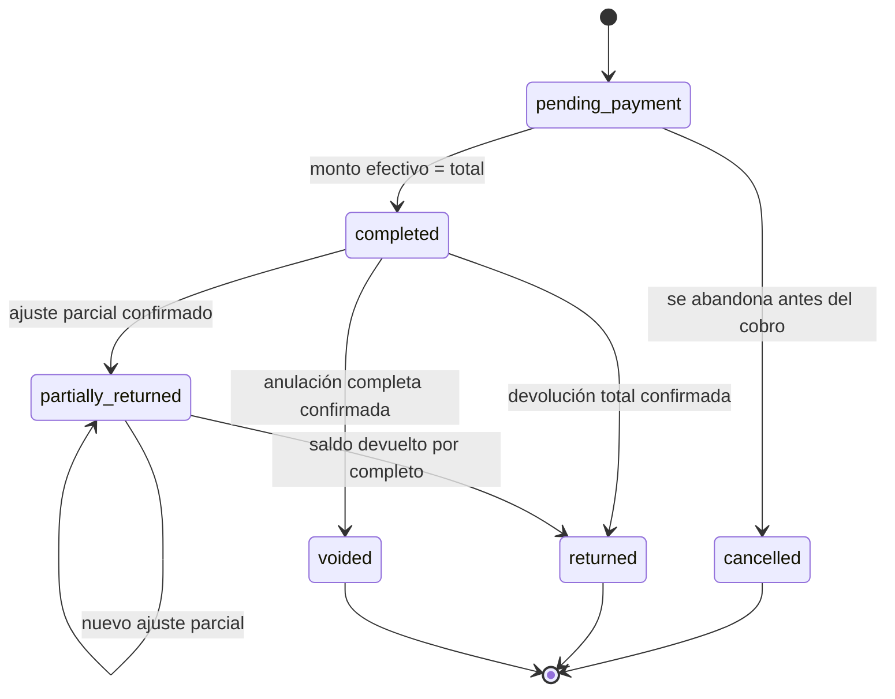
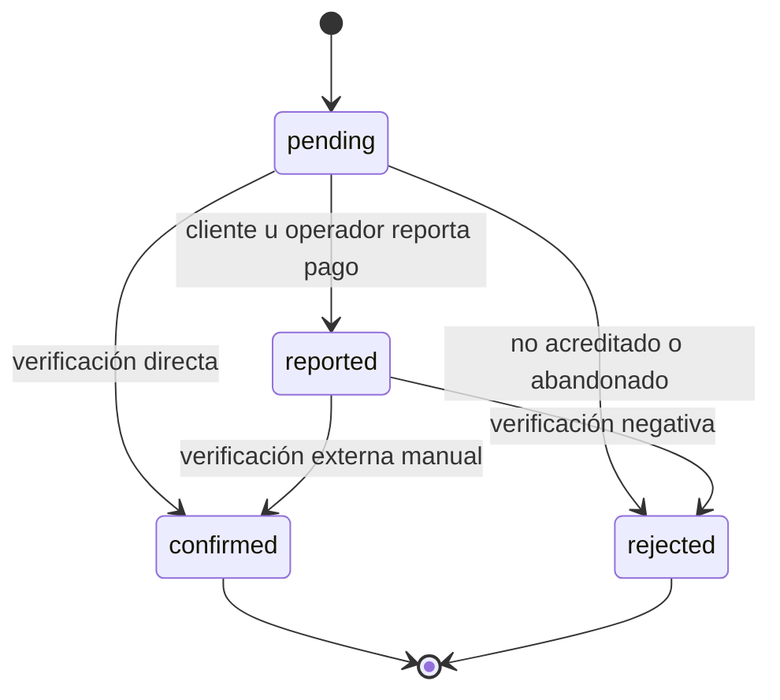
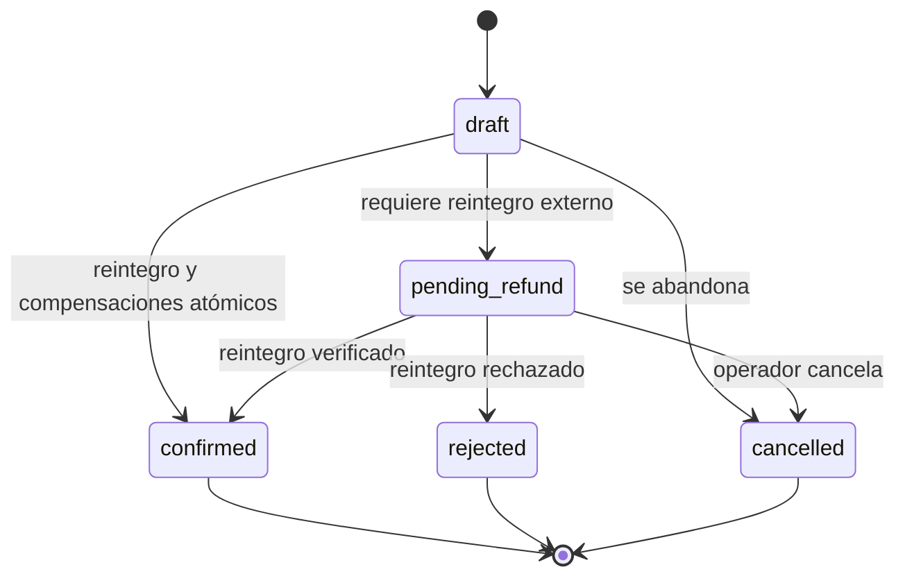
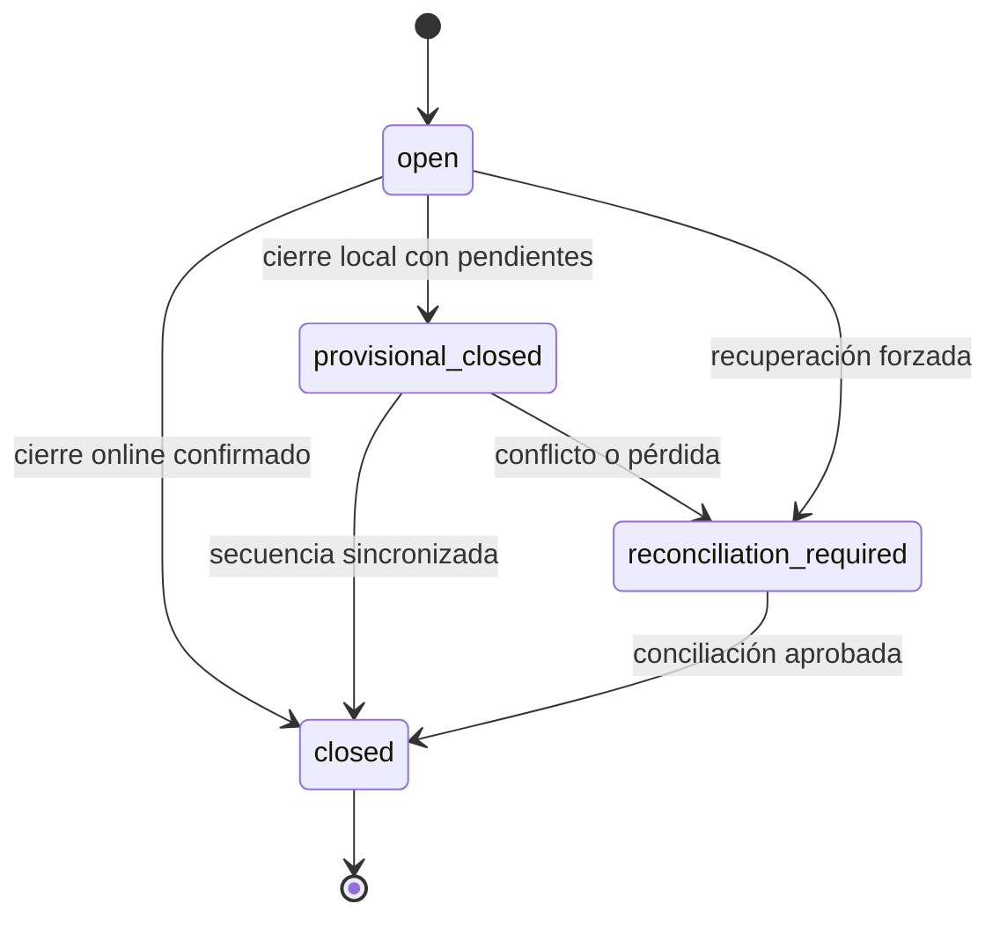

# Máquinas de estados del MVP

- Estado: Aprobado para implementación
- Fecha: 2026-10-11
- Alcance: ventas, pagos, devoluciones/ajustes y turnos de caja

Los nombres en inglés son los valores previstos para persistencia y contratos.
Las etiquetas de interfaz serán en español. Todo cambio de estado genera un
evento de auditoría con actor, timestamp, motivo y request ID. El campo de estado
actual es una proyección; la historia de transiciones no se sobrescribe.

## 1. Venta

La vida de una venta y el grado de verificación de sus pagos son dimensiones
separadas. Un pago rechazado no borra ni cambia automáticamente la vida de una
venta ya entregada.

| Estado | Significado | Efectos permitidos |
|---|---|---|
| `pending_payment` | Existe un checkout pendiente, pero los pagos efectivos no cubren el total. No es una venta cobrada. | No genera venta definitiva, caja ni salida de stock. |
| `completed` | Pagos `reported` + `confirmed` cubren exactamente el total y la operación fue contabilizada. | Snapshot, pagos, caja, inventario, incidencias y auditoría en una transacción. |
| `partially_returned` | Existen devoluciones confirmadas, pero queda saldo neto vendido. | Conserva venta original; sólo agrega compensaciones. |
| `returned` | Se devolvió todo el saldo disponible mediante una o más devoluciones. | Terminal; no admite nuevos ajustes monetarios salvo corrección de la propia devolución. |
| `voided` | La venta fue anulada íntegramente antes de tener devoluciones confirmadas. | Terminal; mantiene todos los registros originales y compensatorios. |
| `cancelled` | El checkout se abandonó antes de completar el cobro. | Terminal; no aparece como venta ni afecta caja/stock. |

### Invariantes

1. El total es igual a la suma de líneas redondeadas.
2. Para pasar a `completed`, la suma de pagos `reported` y `confirmed` debe ser
   exactamente igual al total.
3. Cada venta contabiliza sus efectos una sola vez mediante clave idempotente.
4. `reported` permite completar operativamente, pero la venta queda marcada
   visualmente como cobro no verificado.
5. El rechazo posterior de un pago abre una incidencia; no elimina la venta.
6. El importe y la cantidad devueltos acumulados nunca superan el saldo original.
7. Una corrección es una relación entre la venta, sus compensaciones y una
   posible venta nueva; no es un estado adicional.

## 2. Pago

| Estado | ¿Cubre el total operativo? | ¿Se considera acreditado? | Evidencia mínima |
|---|---:|---:|---|
| `pending` | No | No | Método, monto e intento |
| `reported` | Sí | No | Actor y referencia externa opcional |
| `confirmed` | Sí | Sí | Actor verificador, fecha y mecanismo |
| `rejected` | No | No | Motivo y actor o respuesta externa observada |

### Reglas por medio

- Efectivo recibido: `confirmed`.
- Transferencia, QR o tarjeta no verificados: `reported`.
- Pago digital comprobado por el operador en el canal externo: `confirmed` con
  evidencia de la verificación manual.
- Pago digital offline sin comprobación externa: sólo `reported`.
- Un pago sustituto crea otra asignación; no muta monto ni método del rechazado.
- Contracargos y reversas posteriores son eventos compensatorios, no
  transiciones desde `confirmed`.

### Estado derivado del cobro de una venta

- `pending`: el monto `reported` + `confirmed` es menor al total.
- `unverified`: cubre el total, pero hay al menos un pago `reported`.
- `settled`: todo el total está `confirmed`.
- `issue`: el rechazo posterior dejó el monto efectivo por debajo del saldo
  exigible.

Este valor es derivado; no reemplaza los estados individuales de los pagos.

## 3. Devolución, anulación o ajuste

Los tres tipos comparten una máquina de estados y se diferencian por `kind`:
`return`, `void` o `correction_adjustment`.

| Estado | Significado | Efectos |
|---|---|---|
| `draft` | Datos aún no confirmados. | Ningún movimiento persistente de negocio. |
| `pending_refund` | El ajuste fue validado y reservó el saldo, pero falta verificar el reintegro. | Puede registrar custodia física no vendible; no confirma compensación financiera. |
| `confirmed` | Reintegro y compensaciones confirmados. | Caja, pagos, stock/disposición y auditoría se aplican una vez. |
| `rejected` | El reintegro o ajuste no pudo completarse. | Libera reserva; resuelve la custodia con movimientos compensatorios. |
| `cancelled` | Fue abandonado por el operador. | Igual que `rejected`, con motivo de cancelación. |

### Invariantes

1. Ajustes `pending_refund` reservan importe y cantidades para impedir dos
   devoluciones concurrentes sobre el mismo saldo.
2. `void` debe cubrir todo el saldo y no puede coexistir con devoluciones
   confirmadas previas.
3. `return` puede ser parcial o total.
4. Una devolución digital no pasa a `confirmed` sin verificación externa.
5. La mercadería físicamente recibida mientras el reintegro está pendiente se
   mantiene en custodia no vendible.
6. Al confirmar se elige por ítem `restock` o `waste`; `quarantine` mantiene la
   unidad fuera del stock vendible hasta una decisión posterior.
7. Toda corrección conserva la venta original y vincula explícitamente la nueva
   venta, si existe.

## 4. Turno de caja

| Estado | Significado |
|---|---|
| `open` | Turno operativo con efectivo inicial confirmado. |
| `provisional_closed` | Cierre realizado offline en el dispositivo POS; no produce reporte definitivo. |
| `reconciliation_required` | El turno quedó afectado por pérdida, recuperación forzada o conflicto no automático. |
| `closed` | Cierre definitivo e inmutable. Las correcciones tardías se registran en el turno vigente y referencian éste. |

### Invariantes

1. Existe un solo turno `open` del puesto normal.
2. El mismo dispositivo puede cerrar provisionalmente y abrir el siguiente
   turno offline; ambos eventos se sincronizan en su secuencia original.
3. Una recuperación forzada saca el turno anterior de operación y permite abrir
   uno nuevo vinculado al caso de recuperación.
4. `closed` nunca vuelve a abrirse.
5. El cierre definitivo exige cola sincronizada o conciliación aprobada.
6. La diferencia se calcula con efectivo realmente contado; nunca altera la
   cifra de ventas.

## 5. Concurrencia e idempotencia

- Transiciones mutantes requieren versión esperada del agregado o bloqueo SQL.
- Un reintento con la misma clave y payload devuelve el resultado original.
- La misma clave con payload distinto es conflicto.
- Estados terminales no aceptan la misma transición con una nueva clave.
- La auditoría registra estado anterior, estado nuevo, actor, motivo y entidad
  relacionada, omitiendo credenciales y secretos.
